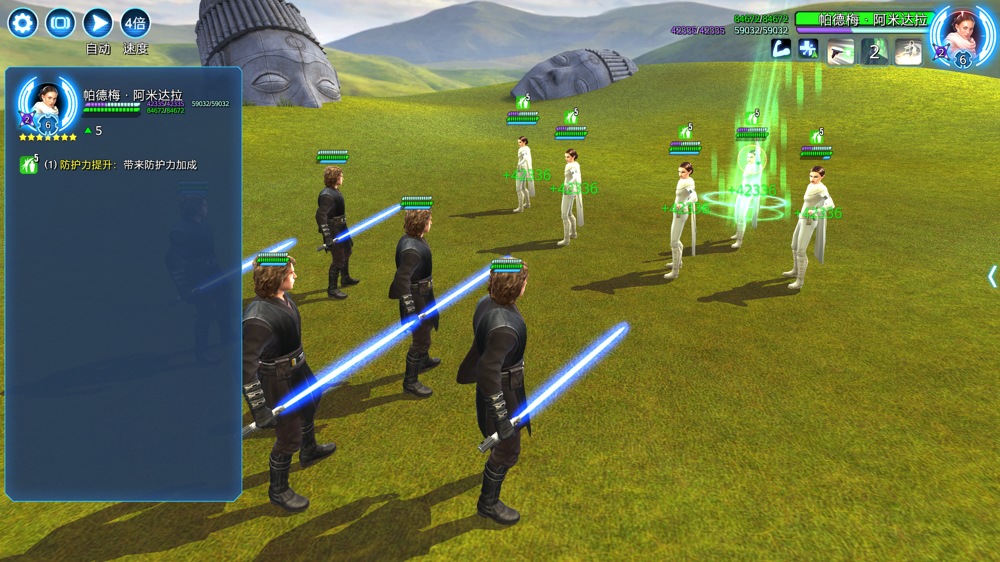
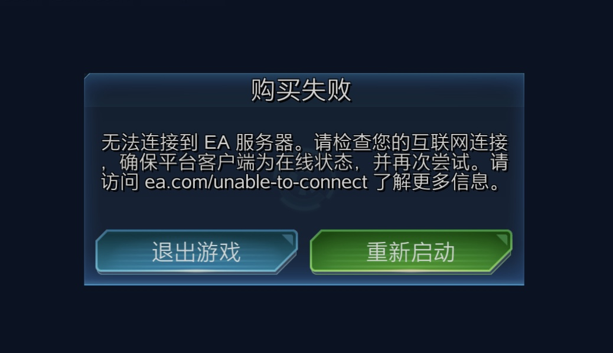

# BlueMilk Pro

把战斗里看不清的信息，直接显示出来。

BlueMilk Pro 是可在 [BlueMilk Editor](https://github.com/LukeSONG2000/bluemilk-editor) 使用的官方信息辅助 Mod。

[下载 Mod 包](https://github.com/LukeSONG2000/bluemilk-pro/releases/latest) · [获取 Editor](https://github.com/LukeSONG2000/bluemilk-editor/releases/latest) · [问题反馈](https://github.com/LukeSONG2000/bluemilk-pro/issues)

## 信息拓展

显示角色的生命值／护盾／临时护盾的绝对值，显示状态效果剩余回合数，显示技能 CD。

## 实时属性

显示角色进入战斗时的初始面板属性和当前实际面板属性。

## 商店购买失败修复

修复商店购买时出现的购买失败问题（如青铜数据卡和 PC 特别神秘宝箱）。

## 独立安装，按需开启

下载 `BlueMilk-Pro-1.0.0.bluemilk`，在 **BlueMilk Editor 1.0.0 或更新版本**中导入或拖入，然后开启 Pro。Editor 不自带 Pro，也不会自动安装任何 Mod。

信息拓展和购买修复可独立开关，主页快捷入口可按喜好隐藏。可在 Editor 的 Mod 管理中检查新版。

[开发与验证](docs/DEVELOPMENT.md) · [MIT License](LICENSE)

BlueMilk 是独立开源项目。游戏资源及示例画面归其权利人所有。
